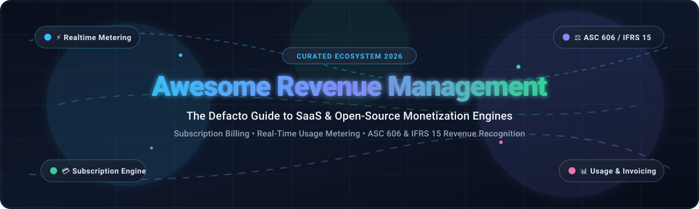
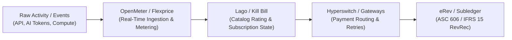

  

  
  
  
  
  
  

---

# 💎 Awesome Revenue Management ⚡

> 🌟 **The Definitive Directory of Enterprise SaaS Solutions & Open-Source Software for Revenue Management, Subscription Billing, Real-Time Usage Metering, and ASC 606 / IFRS 15 Revenue Recognition.**

This repository serves as a comprehensive, industry-benchmarked guide to the modern **Revenue Operations (RevOps)**, **Billing Infrastructure**, and **Monetization Engine** ecosystem. Whether your company is engineering a multi-tier SaaS model, high-frequency AI token consumption rating, contract-level CPQ workflows, or automated multi-element revenue schedules, this curated list covers market-leading SaaS platforms and battle-tested open-source repositories.

---

## 📑 Table of Contents

- [🌐 Sector Overview & Market Dynamics](#-sector-overview--market-dynamics)
- [🏢 Enterprise SaaS & Hosted Revenue Platforms](#-enterprise-saas--hosted-revenue-platforms)
- [💻 Open-Source GitHub Projects](#-open-source-github-projects)
- [🏗️ Reference Architectural Blueprint](#️-reference-architectural-blueprint)
- [🤝 How to Contribute](#-how-to-contribute)
- [📈 Star History](#-star-history)
- [💖 Support & Community](#-support--community)
- [⚖️ Disclaimer & Compliance Standards](#️-disclaimer--compliance-standards)

---

## 🌐 Sector Overview & Market Dynamics

- 📊 **Market Size & Expansion:** The global **Revenue Management and Recurring Billing Software Market** is estimated at **$25.7 billion to $29.0 billion in 2026** and is projected to expand at a compound annual growth rate (**CAGR of 13.0% to 16.4%**) through 2032. Growth is fueled by universal enterprise adoption of hybrid monetization (combining base subscriptions, seat licensing, and real-time usage consumption) alongside automated accounting compliance requirements.
- 🧩 **Market Structure & Fragmentation:** The sector is **moderately fragmented** rather than a winner-take-all monopoly. While massive fintech and enterprise ERP conglomerates (Stripe, Workday, Zuora, Conga) control large payment volumes and enterprise financial sub-ledgers, no single vendor captures the full monetization lifecycle end-to-end. The rapid rise of AI token consumption, API micro-billing, and strict **ASC 606 / IFRS 15** revenue recognition rules has created thriving demand for specialized, best-of-breed metering layers and modular open-source engines that prevent costly vendor lock-in.

---

## 🏢 Enterprise SaaS & Hosted Revenue Platforms

The following table indexes leading commercial revenue management, billing, and recognition platforms. Sorted descending by **Company Scale (Valuation / Revenue)**.

| 🏢 Platform | 🔍 Focus & Core Capabilities | 💰 Company Scale (Valuation / Revenue) | 🏷️ Starting Price | 🎁 Free Tier / Free Trial Limits |
| :--- | :--- | :--- | :--- | :--- |
| **[Stripe Billing](https://stripe.com/billing)** | 💳 Recurring billing, automated invoicing, customer portal, ML-driven smart retries, and high-scale usage-based meter integration across global payment rails. | **~$159 Billion Valuation** ($6.8B net revenue, $1.9T payment volume processed) | **0.70% of recurring billing volume** on pay-as-you-go (plus 2.9% + 30¢ per card charge), or **$620/month flat fee** for up to $100,000/month volume | **Unlimited Free Test Mode** with test clocks, simulated customer events, and full API access without volume caps; $0 fixed monthly charge on live pay-as-you-go |
| **[Workday Revenue Management](https://www.workday.com/)** | 🏛️ Enterprise ASC 606 & IFRS 15 revenue recognition automation, contract modifications, multi-element revenue scheduling, and ERP financial ledger integration. | **~$50 Billion Market Cap** ($9.55B FY2026 total revenue) | **~$150,000/year** (modular enterprise licensing typically ~$100–$150/user/month depending on contract scope and financial suite bundle) | **30-day guided proof-of-concept sandbox trial** provisioned through sales engineering with enterprise demo dataset |
| **[Conga Revenue Management](https://conga.com/)** | 🔄 End-to-end Revenue Lifecycle Management (RLM) unifying CPQ, multi-tier pricing contracts, complex billing, rebate handling, and revenue scheduling. | **~$7.1 Billion Valuation** ($400M+ ARR, Thoma Bravo portfolio) | **$35/user/month** for foundational operational modules, scaling to **~$12,000–$25,000/year** for complete CPQ & Revenue Lifecycle engine | **14 to 30-day proof-of-concept sandbox evaluation** upon sales qualification (restricted to test tenants and sample catalog SKUs) |
| **[Chargebee](https://www.chargebee.com/)** | ⚡ Subscription management, billing lifecycle, smart dunning, multi-currency invoicing, and automated revenue recognition (Chargebee RevRec). | **~$3.5 Billion Valuation** ($150M+ ARR) | **$0 base fee** up to first $250,000 lifetime billing (0.75% overage); or **$599/month** (billed annually at $7,188/year) for Performance plan up to $100k/mo | **Free Forever Starter Plan** up to **$250,000 cumulative lifetime billing**; plus **14-day free trial** on Performance plan with full sandbox access |
| **[Zuora](https://www.zuora.com/)** | 📈 Comprehensive quote-to-revenue engine (Zuora Billing & RevPro) automating recurring subscriptions, complex rating, and ASC 606 revenue recognition. | **~$1.7 Billion Valuation** (Acquired by Silver Lake & GIC; ~$450M ARR) | **~$75,000/year** (~$6,250/month) for entry Launch/Growth packages scaling with subscriber counts and billing volume | **30-day enterprise sandbox evaluation** arranged with sales team (includes test tenant, API access, and sample ledger workflows) |
| **[Maxio](https://www.maxio.com/)** | 📊 B2B SaaS financial operations combining subscription billing (Chargify) and GAAP/IFRS revenue recognition with metrics reporting (SaaSOptics). | **~$450 Million Valuation** ($65M+ ARR, backed by Summit Partners) | **$599/month** for Grow Plan (covers core subscription billing and financial reporting up to $100,000/month billings) | **Free Forever Developer Sandbox ("Build" Plan)** with no expiration for API integration, simulated payment gateways, and subscription testing |
| **[Recurly](https://recurly.com/)** | 🛡️ Subscription lifecycle automation, dunning recovery, multi-gateway payment orchestration, and ASC 606 revenue recognition module (Recurly RevRec). | **~$300 Million Valuation** ($60M+ ARR, backed by Summit Partners) | **$249/month + 0.9%** of billing volume (includes first $40,000 in monthly billings); All-Access plan quoted with volume rates <1% | **90-day free trial** on Starter plan with unlimited sandbox integration testing and 20+ gateway test connections |
| **[BillingPlatform](https://billingplatform.com/)** | ⚙️ Agile enterprise monetization platform supporting dynamic rating, hybrid recurring & usage models, CPQ, and multi-currency billing automation. | **~$250 Million Valuation** ($104M total funding raised, ~$45M ARR) | **~$2,500/month** (~$30,000/year) based on annual contract volume, rating transactions, and add-on modules | **14-day guided test drive trial** with interactive sandbox simulator for product catalogs, invoicing runs, and usage rating |
| **[Aptitude Software](https://www.aptitudesoftware.com/)** | 🏦 Enterprise financial sub-ledger automation, ASC 606 / IFRS 15 compliance (Fynapse & RevStream), and revenue calculation for financial institutions and telecom. | **~£130M / ~$165M Market Cap** (LSE: APTD; ~$80M+ revenue) | **~$40,000/year** for foundational sub-ledger and automated revenue recognition rules engine | **30-day proof-of-value sandbox assessment** coordinated with solutions architects (includes custom data-mapping review) |
| **[RightRev](https://rightrev.com/)** | 📑 Native ASC 606 and IFRS 15 automated revenue recognition engine built for seamless integration with Salesforce, NetSuite, and enterprise ERPs. | **~$60 Million Valuation** ($13M+ venture capital raised, ~$10M ARR) | **$24,000/year** (~$2,000/month) for core revenue contract processing and automated amortizations | **14 to 30-day assisted sandbox trial** provided during enterprise technical discovery with synthetic revenue contracts |

---

## 💻 Open-Source GitHub Projects

Curated open-source projects providing subscription management, usage metering, rating engines, automated invoicing, and revenue recognition. Sorted descending by **GitHub Star Count**.

### 1. 🔀 [Hyperswitch](https://github.com/juspay/hyperswitch) 
- **License:** Apache-2.0  
- **Primary Focus:** Composable payment routing, revenue recovery & smart checkout orchestration  
- **Description:** High-performance, open-source payment switch written in Rust. It unifies hundreds of payment processors, card acquirers, and local payment methods under a single API. Features automated smart retries, intelligent dynamic routing to minimize decline rates, network tokenization, and multi-entity fee tracking—slashing payment ops overhead and preventing subscriber churn.

### 2. ⚡ [Lago](https://github.com/getlago/lago) 
- **License:** AGPL-3.0  
- **Primary Focus:** Usage-based metering, hybrid subscription billing & pricing iterations  
- **Description:** Developer-first metering and billing engine built as an open-source alternative to Stripe Billing and Chargebee. Supports event-based consumption tracking, tiered pricing, pay-as-you-go, prepaid credits, coupons, and automated invoice PDF generation. Provides native GraphQL APIs, webhook alerting, and Docker Compose deployment for rapid integration.

### 3. 📚 [Akaunting](https://github.com/akaunting/akaunting) 
- **License:** GPL-3.0  
- **Primary Focus:** Full-suite accounting, client invoicing & financial management  
- **Description:** Mature modular accounting software designed for small businesses and freelancers. Features recurring invoice scheduling, revenue tracking, customer deposits, automated payment reminders, and multi-currency ledgers. Expandable with hundreds of marketplace apps for payment gateway integration and tax compliance.

### 4. 🧾 [Crater](https://github.com/crater-invoice-inc/crater) 
- **License:** AGPL-3.0  
- **Primary Focus:** Invoicing suite, recurring billing & payment tracking  
- **Description:** Complete open-source invoice management platform built with Laravel and Vue.js. Provides web and mobile apps to track estimates, recurring invoices, client balances, payment proofs, and detailed billing reports with frictionless Docker-based deployment.

### 5. 🏷️ [Flexprice](https://github.com/flexprice/flexprice) 
- **License:** AGPL-3.0  
- **Primary Focus:** Usage-based pricing, realtime metering & entitlement controls  
- **Description:** Developer-focused pricing and billing engine that turns high-throughput usage events into accurate billable metrics. Offers credit wallets, prepaid drawdowns, feature access gating, and dynamic price experimentation with an intuitive no-code management UI.

### 6. 🛡️ [Kill Bill](https://github.com/killbill/killbill) 
- **License:** Apache-2.0  
- **Primary Focus:** Enterprise-grade subscription billing, dunning & payment orchestration  
- **Description:** In production since 2010, Kill Bill is the most mature open-source subscription billing platform in existence. Handles complex multi-tier product catalogs, subscription state machines, invoice generation, payment gateways, automated dunning schedules, and multi-tenant architectures. Operates without vendor lock-in on custom infrastructure.

### 7. 📑 [InvoicePlane](https://github.com/InvoicePlane/InvoicePlane) 
- **License:** MIT  
- **Primary Focus:** Self-hosted client management, quote generation & recurring invoices  
- **Description:** Clean, reliable PHP-based billing application for managing customer accounts, quotes, recurring invoices, and payment tracking across 25+ payment providers with zero external dependencies.

### 8. 🛍️ [Paymenter](https://github.com/Paymenter/Paymenter) 
- **License:** MIT  
- **Primary Focus:** Hosting billing platform, customer portal & service automation  
- **Description:** Tailored for hosting providers and digital service companies. Automates recurring client subscriptions, order checkout, service provisioning extensions, invoicing, and support ticket management with a modern responsive frontend.

### 9. ⏱️ [OpenMeter](https://github.com/openmeterio/openmeter) 
- **License:** Apache-2.0  
- **Primary Focus:** Real-time event metering & consumption-based monetization for AI & APIs  
- **Description:** Cloud-native monetization infrastructure engineered to process millions of consumption events per second. Ingests raw usage logs (e.g., LLM tokens, compute seconds, API calls) via Kafka/ClickHouse, enforces real-time customer rate limits, and aggregates usage data directly into downstream billing engines.

### 10. 📦 [Lotus](https://github.com/uselotus/lotus) 
- **License:** MIT  
- **Primary Focus:** SaaS pricing experimentation, feature entitlement & subscription packaging  
- **Description:** Open-source monetization infrastructure providing rapid pricing plan iteration, seat-based and usage-based hybrid billing, and automated customer entitlement enforcement with seamless Stripe integration.

### 11. 🐍 [dj-stripe](https://github.com/dj-stripe/dj-stripe) 
- **License:** MIT  
- **Primary Focus:** Django ORM synchronization for Stripe Billing & recurring subscriptions  
- **Description:** Python framework that mirrors all Stripe Billing objects (subscriptions, customers, invoices, payment methods) directly into Django database models. Automates webhook reception and eliminates manual Stripe API sync code.

### 12. 🔧 [FOSSBilling](https://github.com/FOSSBilling/FOSSBilling) 
- **License:** Apache-2.0  
- **Primary Focus:** Lightweight billing engine, recurring subscriptions & client management  
- **Description:** Community-driven fork of BoxBilling providing an efficient, lightweight self-hosted billing system for digital agencies and hosting businesses. Handles automated invoicing, recurring renewals, and modular payment gateways.

### 13. 📊 [Meteroid](https://github.com/meteroid-oss/meteroid) 
- **License:** AGPL-3.0  
- **Primary Focus:** Pricing packaging, grandfathering, cost-limiting & revenue analytics  
- **Description:** Modern billing infrastructure designed to orchestrate complex subscription plans, consumption metrics, customer grandfathering rules, and churn-prevention workflows with embedded revenue analytics.

### 14. 💼 [SolidInvoice](https://github.com/SolidInvoice/SolidInvoice) 
- **License:** MIT  
- **Primary Focus:** General invoicing, client billing quotes & notification automation  
- **Description:** Clean, Symfony-powered open-source billing system supporting recurring invoicing schedules, estimate conversions, payment gateway webhooks, and client account ledgers.

### 15. 🐻 [BillaBear](https://github.com/billabear/billabear) 
- **License:** AGPL-3.0  
- **Primary Focus:** Stripe-native subscription management, tax computation & dunning  
- **Description:** Standalone subscription management system that sits atop Stripe. Adds sophisticated multi-plan subscriptions, automated tax calculation, dunning workflows, PDF invoice templating, and customer management without vendor lock-in.

### 16. 🐝 [UniBee](https://github.com/UniBee-Billing/unibee) 
- **License:** AGPL-3.0  
- **Primary Focus:** Multi-tenant subscription management, billable metrics & discounts  
- **Description:** Universal SaaS billing engine supporting tiered pricing, metric aggregation, discount coupons, email receipts, and multi-gateway orchestration with out-of-the-box Docker deployment.

### 17. ⚖️ [eRev](https://github.com/ChipmunkRPA/eRev) 
- **License:** Dual License (Free Tier / Commercial)  
- **Primary Focus:** ASC 606 & IFRS 15 automated revenue recognition engine  
- **Description:** Dedicated local-first Python engine for revenue recognition compliance. Ingests contractual obligations, allocates transaction prices across distinct performance obligations, and automates monthly revenue amortization schedules without recurring SaaS fees.

### 18. 🗄️ [BillKu](https://github.com/ribato22/BillKu) 
- **License:** MIT  
- **Primary Focus:** Self-hosted business management, recurring invoicing & POS  
- **Description:** Full-stack NestJS and Next.js billing suite offering offline-capable point-of-sale, recurring invoice generation, CRM account management, and financial reporting.

---

## 🏗️ Reference Architectural Blueprint

When building a modern, cloud-native revenue architecture, no single open-source system covers the complete pipeline. A proven enterprise self-hosted stack combines:

1. **Ingestion & Metering:** **OpenMeter** or **Flexprice** for high-throughput event aggregation and real-time quota enforcement.
2. **Subscription Lifecycle & Invoicing:** **Kill Bill** or **Lago** for price catalog modeling, customer dunning, and invoice generation.
3. **Payment Orchestration:** **Hyperswitch** to route payments across gateways, eliminate transaction failures, and minimize merchant fees.
4. **Revenue Recognition:** **eRev** or ERP sub-ledgers for ASC 606 / IFRS 15 compliance, performance obligation amortization, and journal entries.

---

## 🤝 How to Contribute

Contributions are warmly welcomed! Help keep this directory accurate, objective, and up-to-date:

1. 🍴 **Fork this repository**.
2. 🌿 **Create a new branch**: `git checkout -b add-tool-name`.
3. 📝 **Add or update entries** in `README.md` adhering to the standard tabular/bullet format:
   - Provide verified starting prices and explicit free tier/trial limits.
   - Include company valuation or ARR scale for SaaS platforms.
   - For open-source tools, include repo links, license, and the star badge.
4. 🚀 **Commit your changes**: `git commit -m "Add ToolName to revenue management ecosystem"`.
5. 📤 **Push to branch**: `git push origin add-tool-name`.
6. 📬 **Submit a Pull Request** with a concise description of the product or updates.

---

## 📈 Star History

---

## 💖 Support & Community

Thank you for exploring **Awesome Revenue Management**! 🚀

Building and maintaining high-quality curated technical resources takes dedication and continuous research. If this repository has helped you evaluate pricing infrastructure, navigate ASC 606 / IFRS 15 compliance, or select an open-source billing engine for your tech stack:

- ⭐ **Star this repository** to help other developers, finance engineers, and RevOps professionals discover it.
- 🍴 **Fork it** to contribute new tools, benchmarks, and architectural patterns.
- 📢 **Share it** on X / LinkedIn / Reddit / Discord with fellow developers and finance teams.
- ☕ **Buy a coffee or sponsor development:** Support ongoing curation via the [GitHub Sponsor Dashboard](https://github.com/sponsors/ishandutta2007).

Your support keeps this directory active, accurate, and community-driven! 🙏

---

## ⚖️ Disclaimer & Compliance Standards

- 📌 **Independent Community Directory:** This repository is an independent, community-maintained resource. Inclusion does not imply official endorsement or commercial affiliation.
- 📜 **Regulatory Standards:** Revenue management tools handling financial transactions, billing, and accounting entries must comply with applicable accounting frameworks (**ASC 606, IFRS 15**), regional tax standards, and data security standards (**PCI DSS Level 1**, SOC 1 / SOC 2).
- 🔍 **License & Commercial Terms:** Always verify license terms for open-source projects before enterprise deployment (e.g., Apache-2.0, MIT, AGPL-3.0).

---

  <b>Made with ❤️ for revenue operations teams, billing engineers, controllers, and finance architects.</b>

